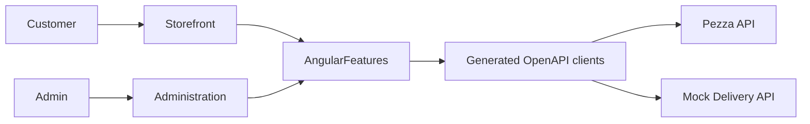

# Architecture

## Learning application

Pezza Pizza Store is one evolving Angular application. Each phase starts from the previous learning milestone and adds a focused capability. The separate end project is a working reference, not a disconnected tutorial.



## Frontend boundaries

The target application uses standalone Angular components, external templates and stylesheets, feature-oriented organization, strict TypeScript, and signals for UI state. Components render and coordinate user interaction; feature services own reusable application behavior; API clients form the HTTP contract boundary. Keep server state distinct from transient UI state.

```text
src/app/
  core/          app-wide configuration and cross-cutting services
  shared/        reusable UI primitives and utilities
  layouts/       customer and admin shells
  features/
    catalogue/
    basket/
    checkout/
    orders/
    delivery/
    admin/
```

This is the destination structure, not a requirement to create empty abstractions in the first phase. The codebase should acquire boundaries when the learning phase needs them.

## Phase progression

| Phase | Application boundary introduced |
|---|---|
| 1–2 | Standalone components, services, inputs/outputs, and local signal state |
| 3–4 | Lazy feature routes, layouts, and validated customer forms |
| 5–6 | Generated HTTP clients, API boundaries, and feature-level reactive state |
| 7–8 | Test seams, identity integration, and UI access controls |
| 9–10 | Optimus UI, design tokens, and offline-aware PWA behavior |
| 11–12 | Production delivery and responsible AI-assisted development |

## Technology decisions

- **Angular 22 / TypeScript 6:** use the current framework APIs and strict compiler checks.
- **Node 24 LTS:** Angular 22's compatibility table requires Node `^24.15.0` for the Node 24 line.
- **Standalone and zoneless:** use standalone bootstrap and zoneless change detection from the beginning.
- **Signals first:** use `signal`, `computed`, and `linkedSignal` for synchronous UI state. Use effects only for side effects, and RxJS where streams/interoperability are a genuine fit.
- **Forms:** introduce Angular Signal Forms for the checkout learning exercise; validate external API data at boundaries rather than duplicating every form rule.
- **API contracts:** generate clients from discovered Pezza and delivery OpenAPI contracts; do not hand-maintain duplicate generated DTOs.
- **Styling:** introduce Tailwind and Optimus UI as the design-system phase approaches. Optimus UI is the open-source continuation of PrimeNG v21; verify its current package APIs and peer versions before wiring it into the app.
- **Testing:** use the Angular CLI's Vitest setup for unit/component tests and Playwright for browser workflows.
- **No default state library:** start with feature-level signal services. Add NgRx only if a later phase demonstrates a concrete need.

## Backend integrations

The incubator contains a local Pezza API reference in `../Intro/API_DOCKER_SETUP.md` and the mock delivery service in `../Pezzza-Mock-Delivery-Service`. Phase 5 will verify API availability and OpenAPI contracts before generating clients or adding Docker Compose dependencies. Until then, Phase 1 uses local sample data and works without services.

## Security boundary

Angular route guards and UI role checks improve navigation and user experience; they do not authorize API operations. Authorization must be enforced by the backend.
